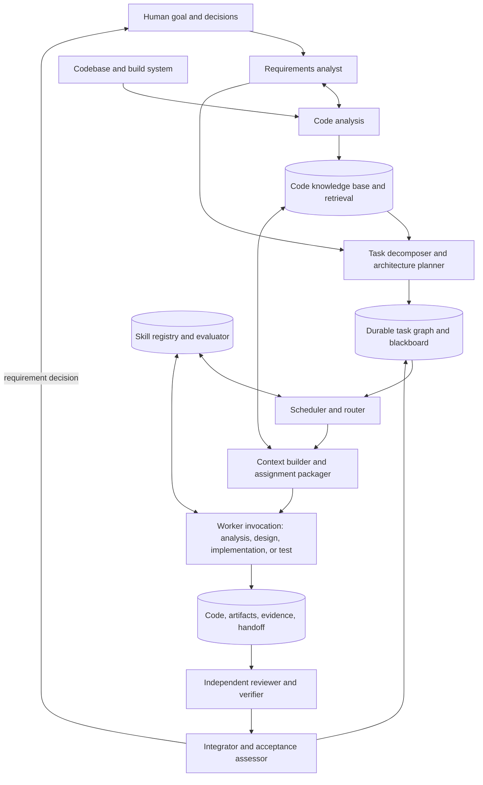

# ASEH: Autonomous Software Engineering Harness

## Purpose

ASEH is a general harness for autonomous software engineering in large existing
codebases. Its long-term goal is to let agents carry complex work that would
normally take weeks or months, while preserving reliability through
decomposition, evidence, durable state, and recovery rather than assuming one
model invocation can complete the whole project. The host repository supplies
the codebase-specific adapter, knowledge, skills, and task storage.

The host adapter supplies repository identity and configurable roots for the
framework, skills, knowledge, task workspaces, task archives, and generated
caches. It also supplies available tools and validation commands. Core graph,
assignment, context, and evidence semantics do not depend on those paths or on a
specific language, build system, or agent runtime.

## Core principles

### Goal-driven, not workflow-driven

The human supplies an outcome and any known constraints. ASEH investigates the
codebase, finds missing requirements, explores solutions, builds a changing
plan, implements, integrates, verifies, and replans until the agreed outcomes
have sufficient evidence.

Do not require a complete upfront design or fixed sequence of steps. Keep the
user's intended outcome distinct from an early proposed implementation. See
[`requirement-refinement.harness.md`](requirement-refinement.harness.md) for the
living requirements process.

### Router + Skill + Agent

- **Router:** Selects the current execution mode, agent role, relevant skills,
  tools, and context policy using the goal, graph frontier, evidence, risk, and
  current uncertainties. It does not classify only by keywords or prescribe
  the complete execution plan in advance.
- **Skill:** Reusable methods for performing a kind of work, including
  procedures, decision rules, tool use, and validation methods. Skills may link
  to codebase knowledge but should not become a duplicate facts catalog. A
  skill is not necessarily an agent or a fixed workflow. Agents may discover, load,
  combine, evaluate, improve, replace, or retire skills as work proceeds.
- **Agent:** Performs reasoning, repository exploration, decisions, and
  actions. Skills inform its choices; they do not remove its ability to choose
  the next useful action within the harness's safety and verification rules.

### Runtime-topology-neutral multi-agent orchestration

ASEH orchestrates **agent invocations**, not a particular agent-runtime
deployment. The same task graph and work contracts must operate when one runtime
executes one assignment at a time, when a runtime is reused across assignments,
or when several runtimes execute independent assignments concurrently. Runtime
count, process lifetime, and scheduling policy are executor concerns; they must
not be assumptions embedded in task state or graph semantics.

The stable orchestration concepts are:

- **Coordinator:** Maintains the task goal, requirements revisions, graph,
  interfaces, risks, and global acceptance state. It may itself be an agent
  invocation, but its durable state is not its conversation history.
- **Work assignment:** A bounded, resumable packet for one agent invocation.
  It identifies the objective, scope, ownership, relevant constraints,
  prerequisites, permitted changes, acceptance evidence, and reporting format.
- **Worker invocation:** An agent selected for a graph node based on capability,
  role, skills, tools, and context needs. It can be scheduled serially or in
  parallel without changing the assignment contract.
- **Durable blackboard and artifacts:** Versioned requirements, graph nodes,
  module contracts, decisions, code changes, experiment results, and verification
  reports persisted in the task workspace. These are the collaboration source
  of truth; chat messages are notifications and handoffs, not authoritative
  state.
- **Integration gate:** Reconciles completed work against shared interfaces,
  code state, global requirements, and evidence before dependent work is
  unblocked or the task is declared complete.

The executor claims ready nodes, constructs assignment packets, invokes the
available runtime, records returned artifacts and events, and updates node
state. A sequential executor may drain one node before invoking the next. A
parallel executor may claim several independent nodes and use isolated worktrees
or branches. Both use the same dependencies, completion rules, and integration
gates.

### Hierarchical decomposition and bounded context

A long engineering task may exceed the useful context of any one agent
invocation. Decompose it into nested scopes while preserving a small global
contract:

1. **Goal level:** User outcomes, confirmed constraints, open decisions, and
   global acceptance criteria.
2. **System level:** Architecture, module boundaries, shared interfaces,
   critical dependencies, and integration risks.
3. **Module level:** A subsystem's design, ownership, local graph, acceptance
   criteria, and dependencies on other modules.
4. **Work-item level:** One bounded investigation, experiment, implementation
   slice, review, or verification assignment.

Each parent scope owns its outcomes, contracts, dependency edges, and
integration status. It delegates bounded work to child scopes and reconciles
their results. A child may propose new subtasks or changes to its scope, but
cross-module contract changes and global requirement changes return to the
parent coordinator for evaluation. This lets agents specialize without losing
system-level consistency.

Do not send the entire task history to every invocation. Assemble context in
layers: stable harness rules; project knowledge relevant to the node; the
current task charter and requirement revision; the module contract; the
assignment packet; and only the referenced decisions, source locations,
artifacts, skills, and evidence needed for that work. Keep large evidence in
files with searchable manifests and concise, attributed summaries. Summaries
must link to source evidence and must not replace it.

Every assignment should be independently understandable and resumable. At a
minimum it carries:

- a precise objective and expected output;
- included and excluded scope plus file/module ownership;
- applicable requirements, assumptions, constraints, and interface versions;
- prerequisite artifacts and links to relevant repository context;
- completion criteria and required validation evidence;
- the expected result format, including new risks, decisions, or graph nodes.

The invocation returns a structured handoff: status, changed files or
artifacts, commands and results, decisions or assumptions introduced, unresolved
risks, and proposed next nodes. The coordinator validates that handoff against
the assignment and actual repository state before updating the graph.

### Context-window-bounded assignments

Every agent task, including top-level analysis and scheduling tasks, must be
small and focused enough for one invocation to complete its assigned output
within that invocation's effective context window. If it cannot, the task is
not ready to dispatch: the decomposer must split it into smaller assignments
with explicit dependency contracts. Do not use a broad title such as
"implement the renderer" as a single worker assignment when the work contains
separable research, API design, backend implementation, integration, and
verification.

Before dispatch, the context builder estimates the assignment's input and
expected output size for the selected runtime, including a reserve for tool
results, reasoning, and the structured handoff. It gathers only the context
needed for the assignment. If context pressure rises unexpectedly, the agent
must save findings and evidence to the workspace, return a partial handoff with
unfinished work identified, and have the decomposer create continuation nodes.
It must not silently omit requirements or claim completion because the window
is nearly full.

Tasks may form a long dependency chain and span many sessions, but each
individual assignment remains bounded and resumable. The parent task's context
is preserved in durable artifacts and summaries rather than carried wholesale
inside every child invocation.

### Logical modules and responsibility contracts

ASEH has distinct logical responsibilities. They may be implemented as
services, agent roles, or a mixture; a logical module does not imply a separate
runtime. The interfaces between responsibilities are durable inputs and
outputs, so sequential and parallel executors can use the same architecture.



Responsibilities and expected handoffs are summarized below. Each dispatched
role has a self-contained playbook under [`roles/`](roles/README.md) with its
scope, minimal inputs, workflow, outputs, and escalation rules. The scheduler
should include only the playbook for the assigned role, the bounded assignment,
and the specific evidence the role needs; a worker does not need to load this
entire architecture document.

| Logical module | Responsibility | Produces |
|---|---|---|
| Requirements analyst | Separates outcomes from proposed means; tracks constraints, assumptions, unknowns, and conflicts; prepares high-impact decisions for the human. | Versioned requirement record and acceptance criteria. | [Playbook](roles/requirements-analyst.harness.md) |
| Code analysis | Answers scoped questions about symbols, dependencies, APIs, build/test paths, platform capabilities, and existing patterns; publishes reusable findings with evidence. | Searchable findings with source references and confidence. | [Playbook](roles/codebase-analyst.harness.md) |
| Code knowledge base / retrieval | Primarily maintained by agents and editable by humans; separates curated knowledge from derived indexes; searches by symbol, module, dependency, concept, test, build target, and platform; checks source freshness. | Reviewable knowledge updates and small evidence packets with provenance, freshness, and links to authoritative source. | [Playbook](roles/knowledge-curator.harness.md) |
| Task decomposer / architecture planner | Turns outcomes and discoveries into bounded graph nodes, module boundaries, versioned contracts, dependencies, and completion evidence. | Task graph revisions and assignment definitions. | [Playbook](roles/architect-decomposer.harness.md) |
| Scheduler / router | Selects ready work, suitable role/skills/tools/runtime, execution order or parallelism, ownership, and retry/recovery policy. | Claimed assignments and scheduling events. | [Playbook](roles/coordinator-router.harness.md) |
| Context builder | Packages the minimum sufficient context for one bounded assignment and reserves room for tool output and handoff. | Invocation context packet with provenance links. | [Playbook](roles/context-assembler.harness.md) |
| Implementer | Changes owned code in normal source locations; updates local tests and returns a reproducible handoff. | Reviewable code diff and local verification results. | [Playbook](roles/implementer.harness.md) |
| Test / verifier | Derives or runs checks against assignment criteria, records environment and results, and distinguishes unavailable checks from passes. | Reproducible validation evidence and failure nodes. | [Playbook](roles/test-verifier.harness.md) |
| Reviewer | Independently inspects requirements, contracts, diffs, and evidence for correctness, omissions, regressions, and interface mismatches. | Findings linked to exact evidence and required follow-up nodes. | [Playbook](roles/reviewer.harness.md) |
| Integrator / acceptance assessor | Combines module outputs, resolves cross-module issues, checks global acceptance, and recommends completion or replanning. | Integration evidence and task-level status decision. | [Playbook](roles/integrator.harness.md) |
| Skill lifecycle manager | Finds capability gaps and evaluates, promotes, improves, deprecates, or deletes skills under the stable control-plane policy. | Versioned skill proposals and evaluation records. | [Playbook](roles/skill-curator.harness.md) |
| Exploration researcher | Reduces uncertainty through bounded investigation and experiments; records hypotheses, evidence, and recommended next actions. | Reusable findings, decisions, and exploration graph updates. | [Playbook](roles/exploration-researcher.harness.md) |

The scheduler may assign a different invocation to review or verify a change.
When only one runtime is available, it can still preserve independent review
by starting a fresh bounded invocation with the task contract, diff, and
evidence, while withholding the implementer's narrative except for factual
handoff data. Independence is a property of the review procedure and evidence,
not of runtime count.

### Code knowledge base

Keep codebase knowledge and reusable skills as separate content types. Knowledge
answers what exists, how the current code behaves, and what evidence supports a
claim; a skill answers how to perform and verify a recurring kind of work. For
example, a module dependency map belongs in knowledge, while the procedure for
adding a backend belongs in a skill. Skills should link to the knowledge entries
they need, and knowledge may link to relevant skills. Load the selected skill
and retrieve only the linked knowledge needed for the current assignment. See
[`knowledge-skill-boundary.harness.md`](knowledge-skill-boundary.harness.md)
for curation and classification rules.

ASEH maintains a codebase knowledge base that agents can query on demand. It
must help an agent answer questions such as "where is this public contract
implemented?", "which modules depend on this interface?", "which tests cover
this behavior?", "how is this backend selected?", and "what is known about
this platform limitation?" It is a retrieval capability for the code analysis
and context-building modules, not a replacement for reading and validating the
source.

The host integration configures a knowledge root and provides its initial
catalog. [`initialization.harness.md`](initialization.harness.md) defines how to
create it.

Keep three kinds of knowledge distinct:

1. **Authoritative source:** Current code, build files, tests, and approved
   module documentation. Code remains the source of truth for implementation
   facts.
2. **Curated project knowledge:** Version-controlled architecture maps,
   vocabulary, constraints, and non-obvious relationships in the configured
   `${KNOWLEDGE_ROOT}/`
   or beside the relevant code as `*.harness.md` / `*.harness.json` files.
   Agents are the primary maintainers, and humans may add, edit, move, or delete
   entries. Markdown carries explanations; schema-validated JSON carries
   structured facts. Knowledge changes are ordinary, reviewable Git changes,
   not private agent memory.
3. **Derived indexes and caches:** Searchable symbol/reference/dependency data
   generated from the current worktree, compiler database, build metadata, and
   test layout. These may be stored in an ignored local cache such as
   `${CACHE_ROOT}/code-index/` and rebuilt; do not require agents to commit a
   large generated index to use the knowledge base.

Start retrieval with exact symbol and text search, language-server definitions
and references, module/dependency maps, and build/test metadata. Semantic or
embedding search may supplement these methods, but must not be the only route
to code facts. Keep retrieval backends replaceable so repository scale or new
tooling does not dictate the harness architecture.

Each returned fact should identify its source path and symbol or section, a
usable location, the indexed commit or content hash, freshness status, and
confidence or evidence type. Return a concise summary with direct references;
do not copy broad code regions into the agent context. Validate high-impact
facts against the current worktree before acting, especially when the worktree
is dirty or the index predates recent changes.

The indexer invalidates or refreshes entries affected by changed files and
their known dependents. When source code and curated notes conflict, trust the
current source for current implementation behavior, mark the note stale, and
create a knowledge-update node when the correction is reusable. Keep task-local
discoveries in `${TASK_WORKSPACE_ROOT}/<task>/` until they are verified and useful
beyond that task; then promote them to the curated knowledge base or a
side-by-side code note. This avoids turning every one-off observation into
permanent project doctrine. Before writing, inspect for human edits and preserve
them; never replace curated files wholesale with generated data. Keep citations
and freshness metadata so humans can correct or remove entries. Derived indexes
remain separate and cannot overwrite human- or agent-curated knowledge.

### Module ownership, parallel work, and integration

Parallelize independent investigations and modules only after their boundaries
are clear enough to avoid conflicting edits. Assign an explicit owner to shared
interfaces and high-conflict files. When multiple workers need to change a
shared contract, create a contract decision node first, then unblock dependent
implementation nodes against a versioned contract.

Concurrent code changes use isolated worktrees or branches when they could
interfere. Integrate through reviewable diffs and narrow verification at each
boundary. Do not equate a worker's local success with system completion: the
integrator checks combined behavior, cross-module assumptions, global
acceptance criteria, and full required validation. If integration reveals a
contract mismatch, create or reopen graph nodes and return work to the relevant
module owners.

Agent roles such as researcher, implementer, module owner, integrator, and
verifier describe responsibilities for an invocation; they do not require
separate persistent agent identities. One runtime may perform all roles over
time, or separate runtimes may perform them concurrently. Verification should
be independent in reasoning and evidence even when the same runtime later
performs it.

### Open-ended exploration

When the path is unknown, use an exploration loop:

```text
Understand → Explore → Form hypothesis → Experiment → Evaluate
                     ↑                         │
                     └── Revise hypothesis ────┘
                                      │
                            Consolidate or implement
```

Exploration may produce architecture proposals, technical findings,
prototypes, new task nodes and dependencies, skill proposals, or revisions to
the requirements. Record the hypothesis, experiment, result, and conclusion so
the next session does not repeat failed work without cause.

### Dynamic task graph

Maintain a versioned, evolving dependency graph rather than a fixed TODO list.
Nodes may represent repository investigations, decisions, hypotheses,
experiments, implementation slices, integration work, or verification. Nodes
have dependencies, status, risk, ownership, and observable completion evidence.

The graph can add, split, merge, block, cancel, replan, or retry work. Preserve
the reasoning and history when graph structure changes. The agent chooses the
next useful action from ready work and can create new nodes when evidence
reveals missing work.

### Evidence-based completion

An agent's statement that work is complete is not evidence. Link each
acceptance criterion to observable results such as build output, named tests,
benchmark data, a runnable sample, platform/device results, API compatibility
checks, or an explicitly recorded manual review. Record the command,
configuration, environment, and result needed to reproduce the check.

Verification should challenge the implementation's assumptions, ideally with a
separate verifier role or independent validation step. Failed checks create
diagnosis and repair work in the graph. Report unsupported environments and
unverified claims explicitly; do not mark them passed.

## Execution modes

Modes are selectable and revisitable, not a rigid pipeline:

- **Orient:** Recover task state, inspect repository status, constraints, graph
  frontier, and recent evidence.
- **Explore:** Reduce important uncertainty with bounded inspection or
  experiments.
- **Design:** Compare viable architectures and update contracts and acceptance
  criteria.
- **Implement:** Deliver small, dependency-aware slices with tests and local
  evidence.
- **Integrate:** Resolve interface mismatches and compose slices into a
  working system.
- **Verify:** Independently challenge behavior, compatibility, performance,
  and platform claims.
- **Recover:** Diagnose failures, restore a known-good state when appropriate,
  update hypotheses, and replan.

The router can switch modes whenever results warrant it. For example, a build
failure may return implementation to exploration if the presumed backend
contract was wrong.

## Durable task state and session recovery

The framework lives under `${HARNESS_ROOT}/`; the host's shared skills and
knowledge live under `${SKILL_ROOT}/` and `${KNOWLEDGE_ROOT}/`. Each concrete
task has a versioned workspace under `${TASK_WORKSPACE_ROOT}/<task>/`, committed
alongside the code changes it tracks. At minimum, the workspace contains `TASK.md` with
the current outcome, requirement revision, decisions, assumptions, graph
summary, next action, and evidence links. Add structured state such as
`state.json` only when a tool needs stable machine-readable data; validate it
against a schema under `${HARNESS_ROOT}/` and keep Markdown as the readable
decision record.

A resumed session starts by reading the task file and relevant structured
state, checking the Git worktree, then reconciling the graph with the actual
code, commits, and verification artifacts. Do not trust stale notes over
current repository state. Persist graph events, assignment handoffs, and
artifact references so work can continue after a runtime exits, context is
compacted, or a different agent instance takes over.

A task workspace may organize this state as follows:

```text
${TASK_WORKSPACE_ROOT}/<task>/
  TASK.md                         shared goal, requirements, decisions, status
  state.json                      machine-readable graph and node states
  events.jsonl                    append-only decisions and transitions
  modules/<module>/               shared module contracts and summaries
  assignments/<assignment-id>.md  one bounded agent assignment and its handoff
  evidence/                       reproducible validation manifests and links
```

`TASK.md` is the shared task charter. Each agent invocation reads that charter
plus only its own assignment file, its role playbook, and linked evidence.
Assignment files keep role-specific scope, instructions, context, progress, and
handoff separate; do not copy the whole task charter into each one. This is a
suggested organization, not a requirement to create empty files. See
[`task-workspace.harness.md`](task-workspace.harness.md) for the file contract.
Define and validate machine-readable files with schemas under
`${HARNESS_ROOT}/`. A parent task workspace owns its whole task graph. Keep child
scopes and agent assignments there unless a child becomes independently
resumable as a task; then give it its own `${TASK_WORKSPACE_ROOT}/<task>/` and let the
parent graph reference that task ID rather than duplicating its state.

After explicit user sign-off or an explicit archive request, move the whole
workspace to `${TASK_ARCHIVE_ROOT}/<task>-<UTC date-time>/`. Preserve task evidence
and record links to the code commits. The host integration supplies the concrete path and archive policy.

## Self-managing skill library

Skills are an evolving capability library. During a task, ASEH may:

1. Find and assess existing skills before creating another.
2. Record a capability gap, repeated successful method, or recurring failure.
3. Generate or revise a candidate skill with scope, triggers, inputs, outputs,
   references, procedures, and validation cases.
4. Evaluate it in isolation against representative success and failure cases,
   including regression checks for existing use cases.
5. Promote a passing candidate, monitor its later use, and improve it when
   evidence warrants.
6. Deprecate and eventually delete obsolete skills after checking references,
   replacements, and recovery history.

Keep candidate changes separate from active skills until they pass their
checks. Preserve provenance and rollback information. A small stable control
plane owns permissions, audit, promotion rules, and recovery; skill changes
cannot silently remove or bypass those rules. The same policy applies when a
candidate improves or replaces skill-management guidance.

## Human control with low interruption

ASEH should make progress with little repeated instruction. It can choose
reversible, low-impact defaults autonomously, label them provisional, and
continue independent work while a decision is pending. It asks the human
controller when evidence cannot resolve a decision that materially changes
product direction, public compatibility, supported platforms, major cost,
irreversible state, or another user-value tradeoff.

Each request for a decision should state the unresolved choice, evidence,
feasible options, consequences, a recommendation with confidence, and work that
can continue meanwhile. The harness may refine and even recommend replacing an
initial interpretation, but must not silently change the human's intended
outcome. Record accepted changes as a new requirements revision.

## End-to-end loop

```text
Recover task state
        ↓
Interpret goal and refine requirements
        ↓
Inspect codebase, risks, and capability library
        ↓
Choose mode, role, skills, tools, and context
        ↓
Select or create a graph node
        ↓
Explore / implement / integrate / verify
        ↓
Record evidence, decisions, and skill feedback
        ↓
Reconcile requirements and task graph
        └─────────────── repeat until evidence meets acceptance
```

Success means the latest agreed outcomes meet their acceptance criteria with
reproducible evidence, remaining limitations disclosed, and task state
recoverable by another session. Passing one phase is not the same as completing
the overall goal.
