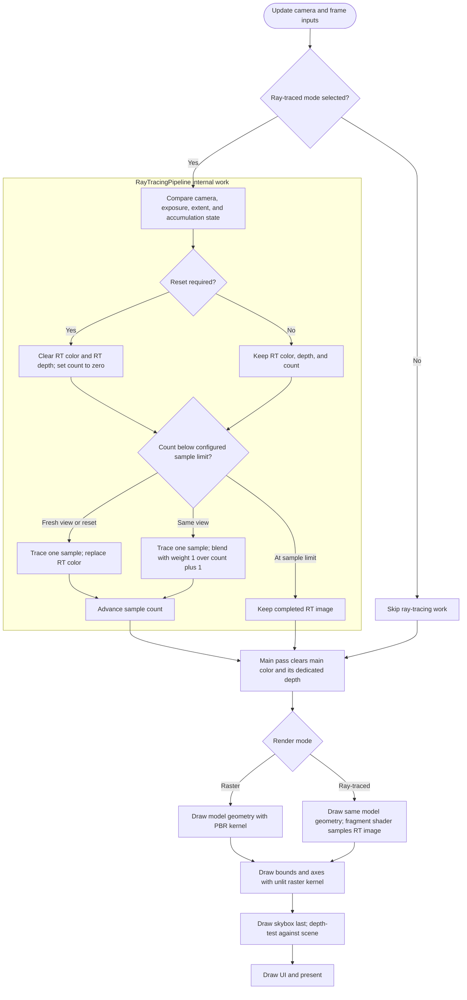

# Mesh viewer

`GNtool-mesh-viewer` displays `.fbx`, `.gltf`, `.glb`, `.stl`, and `.ase` scenes using
FX2 shared constants, gpu2, and the FX2 ImGui backend. It does not use `GNgpu.h`, the
legacy effect system, `SampleApp`, or `FatModel`.

## Run

```bash
source env/garnet.rc
build.py d
build/linux.gcc.d/bin/GNtool-mesh-viewer media/boxes/boxes.fbx
```

Useful noninteractive modes are:

```bash
GNtool-mesh-viewer --print model.glb
GNtool-mesh-viewer --snapshot output.png model.glb
GNtool-mesh-viewer --test --frames 2 model.stl
GNtool-mesh-viewer --frames 120 model.gltf
GNtool-mesh-viewer --rendering ray-traced --rt-samples 512 model.gltf
GNtool-mesh-viewer --surface cel --sphere
GNtool-mesh-viewer --surface unlit --box --snapshot box.png
```

## Target rendering pipeline

The target frame flow has an optional ray-tracing stage followed by the same main scene pass in either mode. `RayTracingPipeline` owns its offscreen RGBA16F image, depth image, scene, and sample count. Its depth image is private and is never attached to the main pass.



When the camera moves, the pipeline resets and traces one fresh sample for that view. When the camera stops, it blends subsequent samples until the configured sample limit, then reuses the completed image. The default limit is 256; `--rt-samples N` sets a different positive limit. Camera, exposure, scene/material, and RT extent changes invalidate accumulated samples. Overlay visibility does not invalidate RT samples because overlays are rendered only by the main pass. The offscreen pass and main pass use matching camera, viewport, and model transforms so the ray-traced image lines up with the real model geometry. The main pass always clears and owns its depth; it never shares the RT pipeline's depth image.

In ray-traced mode, the main pass still rasterizes the model's real geometry. Its special fragment shader fetches the corresponding pixel from the RT offscreen image and outputs that color. This supplies normal model depth for overlay visibility while keeping the traced color. Bounds and axes then render exactly as in raster mode. The skybox is last in both modes; its depth test fills background pixels without covering the model or overlays. UI draws afterward.

`--print` reports hierarchy, primitive/material/texture counts, bounds, and
import warnings without creating a GPU unless combined with `--test` or `--snapshot`.
`--test` renders to a headless target. `--frames N` limits either windowed or
headless execution for smoke testing.

`--snapshot <filename>` automatically enables headless rendering and saves the
final frame as PNG, JPG/JPEG, or BMP according to the filename extension. It uses
the default lighting, bounds, and axes from the interactive
viewer, at 1280x720, with no window or UI. The headless camera is fitted to the
model and uses an elevated three-quarter view (25 degrees yaw, 15 degrees
elevation). By default it renders three frames;
`--frames N` can override that count. Existing output files are overwritten;
the parent directory must already exist. Import, render/readback, unsupported
output format, and file-write failures return a nonzero exit code. `--print`
can be combined with `--snapshot` to also report the imported scene.

Use a Debug build to validate snapshots: gpu2 enables the Vulkan validation
layer and breaks on Vulkan errors by default in Debug builds.

## Controls and UI

Arcball is the default navigation mode:

- left-drag orbits around the fitted model pivot;
- right-drag pans parallel to the screen;
- wheel zoom changes camera distance exponentially for scale-independent,
  natural control.

Fly-by mode uses right-drag to look around the current eye position and
W/A/S/D for time-scaled camera-local movement. Use the UI or `F` to switch
modes, `R` to reset the fitted view, and Escape to close the viewer. Mode
switches preserve the current camera pose.

The ImGui panel provides hierarchy selection, primitive and material details,
import warnings, environment exposure, navigation selection, reset-to-fit,
independent bounds/axes visibility, and frame diagnostics. When ImGui requests
mouse or keyboard capture, the corresponding camera input is suppressed;
Escape remains available to exit.

## Rendering and validation

The viewer retains the imported hierarchy and complete cumulative affine
transforms, including rotation, scale, reflection, and shear. Vertex/index
buffers are shared by instances; shaders apply world and inverse-transpose
normal transforms. Singular transforms are rejected.

`--surface` chooses PBR, cel, unlit, or Lambertian shading for model primitives.
It is a retained command-line spelling, not an FX2 Surface object. Without it,
imported unlit materials remain unlit and other materials use PBR. `--box` and
`--sphere` generate tool-owned CPU meshes. Bounds and axes use unlit shading.

Camera exposure defaults to 1 for explicitly selected cel shading and 0.002
otherwise. Use `--exposure <value>` or the UI slider to change it. Lit output
uses camera exposure; unlit output bypasses it.

The viewer owns import, source hierarchy, inspection, navigation, window and
swapchain lifetime, resource uploads, and frame submission. It has no E2 or
RDG2 dependency. Each frame submits SSC and ImGui uploads before model/debug,
skybox, and ImGui draws in one raster payload. SSC uses one scene/camera UBO
pair: the next frame's upload follows the previous frame's consumers.

`fx2::ImGuiBackend` consumes the native window and records gpu2 draws directly.
It is not an E2 overlay. Camera controls honor its keyboard/mouse capture.

Rendering is split into three application-owned stages:

1. `model-scene.cpp` and `model-geometry.cpp` import/generate CPU data and validate hierarchy without creating a GPU.
2. `SceneRenderer::prepare()` uploads each primitive and texture once, retains complete instance transforms, and creates typed FX2 kernels.
3. `SceneRenderer::record()` appends typed PBR/cel/Lambertian/unlit and skybox draws to the frame's shared raster pass. Both interactive and headless modes call this same function. The main loop handles camera/UI updates, presentation, and ordered submission.

The renderer uses only public FX2/gpu2 headers. There are no viewer-owned shader programs, descriptor layouts, material UBOs, or FX2 geometry/surface assets. The small `RenderModel` records are viewer data: GPU buffer bindings, sampled texture views, typed parameter values, and affine instances. Buffers and textures remain shared across instances. Culling and mirrored front-face selection are caller state; kernels only override state required by their algorithms.

Each frame submits private parameter uploads and SSC uploads before the raster that consumes them. Initialization remains retained until the first successful submission. SSC has one GPU version, so a later frame's shared uploads must follow the previous frame's consumers; collecting several frames' SSC uploads before their rasters would be incorrect.

The automated corpus covers project FBX files, Asset Foundry glTF/FBX assets,
Assimp GLB/STL fixtures, and the Digital Forge/Asset Foundry 110 MB character
GLB stress model. Run the primary checks with:

```bash
build.py d
build.py --clang d
build/linux.gcc.d/bin/GNtest-internal
build/linux.gcc.d/bin/GNtest-internal "[viewer]"
env/bin/format-all-sources.py -dqn
env/bin/cit.py -l
```

Known limitations:

- Assimp rejects pre-2011 FBX files;
- skeletal animation is not evaluated; animated files display static imported
  geometry;
- a display server is required for presentation and interactive input;
- Vulkan validation output requires the Khronos validation layer installed;
